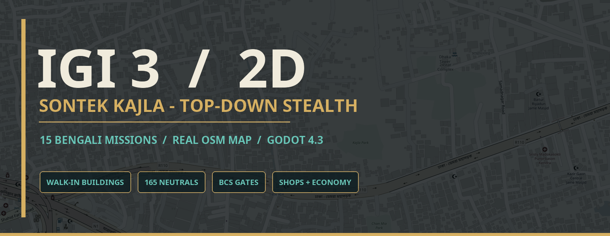
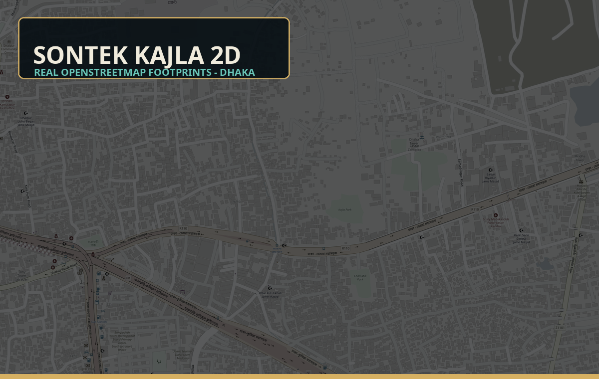
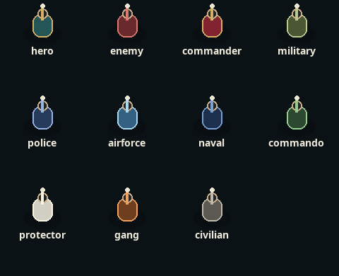

# IGI 3 2D — Sontek Kajla

[](https://github.com/Sakibpedia/igi3-2d/actions/workflows/build_exes.yml)



**A top-down 2D version of the IGI 3 Sontek Kajla campaign**: 15 Bengali stealth missions across a real OpenStreetMap neighbourhood of Dhaka. Built with **Godot 4.3**, no external downloads required.



## Play

Download `IGI3_2D.exe` from the [Releases page](https://github.com/Sakibpedia/igi3-2d/releases) or the Actions artifact, then double-click it. Windows SmartScreen may warn because the build is not code-signed — choose **More info → Run anyway**.

## What is in the game

- **1,500 real OSM building footprints** drawn as top-down polygons with street doors, interior floors and roof access. The collision system uses a spatial grid so hundreds of actors stay responsive.
- **15 chained missions** with 7–10 objectives each: reach, photograph, collect, wiretap, sabotage, eliminate a commander, disable alarms, infiltrate, survive a hold, BCS gates and timed extraction.
- **Safe shops** (pharmacy, clinic, arms dealer, grocery, general store, mobile shop, tea stall and hardware store) selling ammo, medkits, bandages and permanent +25 HP upgrades; enemy loot can be sold. Wallet and upgrades persist between missions.
- **165 neutral actors** in squads: military, police, air force (a death calls an airstrike), naval commandos, bomber commandos and a white-clad civilian protector. They never fire first but retaliate as a group.
- **200 civilians** and **18 knife gangs** roam the lanes; harming civilians costs points and raises the alarm.
- **Bengali HUD** with objectives, minimap built from the OSM data, time, alarm level, wallet, rank and trade/gate panels.
- IGI-style touches: hero-only scope (8), thermal vision (T), drivable vehicles, hitscan shooting and a procedural sound bank.



## Missions

| # | Mission | # | Mission |
|---:|---|---:|---|
| 01 | Kajla Recon | 09 | Hatirjheel Bridge |
| 02 | Document Run | 10 | Lalbagh Fort |
| 03 | Park Stakeout | 11 | Karwan Bazar |
| 04 | R110 Sabotage | 12 | Airport Dawn |
| 05 | Final Sweep | 13 | Buriganga Night |
| 06 | Rooftop War | 14 | Parliament Zone |
| 07 | Diplomatic Compound | 15 | Final Operation |
| 08 | Motijheel Nightfall | | |

Medals (Gold/Silver/Bronze), ranks, unlocks and mid-campaign progress are saved in `user://igi3_2d.cfg`.

## Controls

```
WASD / arrows  move        Shift sprint        Ctrl crouch (quiet, slow)
LMB fire                   E interact / shop / BCS gate / enter building / vehicle
R medkit                   F bandage           8 scope        T thermal
M enlarge map              Esc cancel / pause  Tab objectives (HUD)
BCS gate: keys 1-4         Shop: keys 1-5      Result: R retry, M menu
```

## Repository layout

```
project.godot                Godot 4.3 project (main scene MainMenu.tscn)
assets/maps/kajla.json       6,481 real OSM footprints + 341 roads (ODbL)
assets/maps/kajla_osm.png    OSM raster used on the menu and background
assets/sprites/              Procedurally generated top-down actor art
assets/fonts/                Noto Sans / Noto Sans Bengali
scripts/autoload/Game.gd     Mission data, wallet, medals, save file
scripts/world/City2D.gd      OSM city rendering + spatial collision grid
scripts/world/Mission2D.gd   Objectives, AI, shooting, economy, gates
scripts/world/Actor2D.gd     Hero / guards / neutrals / civilians
scripts/ui/HUD.gd            Bengali HUD, minimap, trade and BCS panels
tools/make_visuals.py        Regenerates all art and README images
tools/test/                  Headless regression suites
.github/workflows/           Windows build + tests on every push
```

See [CITY_DESIGN_2D.md](CITY_DESIGN_2D.md) for the design notes.

## Build and test locally

```powershell
godot --headless --path . --import
python tools/make_visuals.py
godot --headless --path . res://tools/test/CityTest.tscn
godot --headless --path . res://tools/test/SaveTest.tscn
$env:MISSION = '1'; godot --headless --path . res://tools/test/MissionTest.tscn
powershell tools/test/run_all.ps1            # all 15 missions (smoke)
powershell tools/test/run_all.ps1 -Deep      # all 15 missions (playthrough checks)
godot --headless --path . --export-release "Windows Desktop"
```

Each test prints `[CITY2D]`, `[SAVE2D]`, `[IGI2D]` or `[PLAY2D] PASS` and exits with 0. Full results are in [docs/VERIFICATION_2D.md](docs/VERIFICATION_2D.md); the neutral review and list of fixes are in [docs/REVIEW_2D.md](docs/REVIEW_2D.md).

## Credits and licensing

- Game code, design and generated art: **S M Nazmuz Sakib**. No open-source license is granted for the original work.
- Map data: © [OpenStreetMap contributors](https://www.openstreetmap.org/copyright), ODbL 1.0.
- Fonts: Noto Sans / Noto Sans Bengali (SIL Open Font License 1.1).
- This is an independent 2D reinterpretation of the IGI 3 Sontek Kajla campaign, not an official IGI product.
